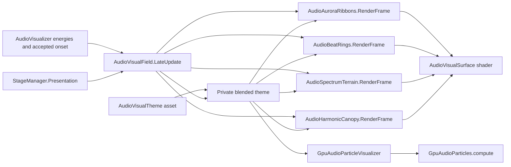

# 音乐空间视觉研究

本轮目标：在现有桌面、音频分析、舞台、星尘和流星之外，增加有统一配色、不同时间尺度和空间层次的可编辑图形内容。恢复点：`codex/visual-research-before-20261022`。保留起始 `.gitignore`、`ProjectSettings/ProjectSettings.asset` 和 `showcase/` 改动；只做本地提交。

## 资产规格

| 项目 | 本轮基线 |
| --- | --- |
| 引擎 | 当前工程 Unity 6000.3.11f1、URP 17.3；Windows PC XR，头显预算待实测 |
| 形状语言 | 极光光带、节拍光环、频谱历史地形；安静时留白，高潮时增层 |
| 颜色 | 青蓝、紫罗兰、琥珀、翡翠四种可编辑主题；一个主色、邻近色及少量高光 |
| 空间 | 米、Y-up；以 Screen 为局部坐标，主要位于两侧、下方和后方；中央阅读区屏蔽、近眼渐隐 |
| 几何 | 初始 6 条细分光带、最多 8 圈节拍环、48×48 频谱历史网格；不新增实时灯和碰撞 |
| 材质 | 原生 URP 非光照透明 Shader，程序化纹理，无外部位图；双眼实例化入口、深度测试及近眼渐隐 |
| 数据 | 复用 AudioVisualizer 的音频能量和真实瞬态；复用 StageManager 的只读输出；手动演示输入与真实音频明确区分 |
| 编辑 | ScriptableObject 主题、Prefab 参数、Editor 安装/修复、预览实验场和可重复渲染入口 |
| 源与许可 | 本项目 C# 网格生成器、Shader、参数资产即完整制作源；本轮原创，无外部下载素材 |
| 验收 | Unity 导入、Shader、资产重载、生命周期、瞬态去重、静音、几何边界、接管及后台真实帧；静态构建另记 |

## 工作单元

1. 原生可编辑光带、节拍环和频谱历史：独立实验场、主题资产、预览和主场景安装。
2. 现有 GPU 粒子的可选形态与过渡：保留原星尘默认，使用可调参数增加空间图案。
3. 视觉编排、主题切换与运行时控制：统一色彩、过渡与强度，避免效果同时抢占注意力。
4. 回归、真实音频回放、代表性画面和持续运行：只记录实际证据；头显缺失时明确留待设备验证。

每个单元完成后在下方记录入口、验证与本地提交。未通过导入、运行和效果检查的内容不作为完成交付。

## 2026-10-22 第一轮实现与实测

- 新增原生光带、瞬态环和频谱历史地形，四个主题、材质、Prefab、独立实验场均为真实 Unity 资产。光带包含细纤维、多尺度流动噪声、雾层和高光；环包含分段轨迹与扫描亮点；地形包含网格、等高线和节点。
- 原 GPU 星尘增加可选三臂星系、环面及连续过渡，默认仍为 Stardust；形态固定到场景锚点，保留相机移动补偿与近眼距离限制。空间主题可以同步粒子颜色。
- 主场景已接入现有 AudioVisualizer、StageManager 和 Screen；演示信号只在实验场启用。主题使用私有副本平滑过渡，不修改共享资产。
- 已执行 Unity C# 导入、Shader 检查、网格边界/复用、瞬态去重、重新启用、静音衰减、历史缓存和主题隔离验证；GPU 三种模式实际 dispatch/readback 的位置有限且位于配置范围内。
- 实验场桌面 Play Mode 运行约 142 秒，确认星系、环面及三层网格效果可见，运行后段无新增错误。修复 PreviewRenderUtility 中未启用对象不触发 OnDestroy 的资源泄漏；验证及主题预览前后网格数量为 80 → 80。
- `dotnet build Assembly-CSharp.csproj --no-restore --nologo` 基线因既有 PerformanceMonitorPanel 的 LibreHardwareMonitor/Computer 引用缺失失败：13 个 MSB3277 警告、2 个错误。不能将 Unity 导入成功等同于此命令通过。
- 无头显，XR 启动有 MetaXR ErrorFormFactorUnavailable。真实音乐听测、XR 双眼效果、设备性能、黑屏下后台帧推进尚未验证。NightDesk 当前处于用户接管状态，遵守接管，不自动恢复遮罩。

证据保存于项目 `Temp/AudioVisualResearch/`，不提交生成截图与机器日志。

## 使用与运行链路

入口为 `Tools/MR-VD/Spatial Audio`：生成缺少资产、安装/修复当前场景、升级实验场、生成主题联系图，以及执行网格与 GPU 验证。安装操作应在 Edit Mode 执行；现有主题和 GPU 默认模式会保留。实验场使用显式合成输入，不能用它证明真实音频分析准确。

源码入口：[AudioVisualField](../Assets/AudioVisuals/Runtime/AudioVisualField.cs)、[主题](../Assets/AudioVisuals/Runtime/AudioVisualTheme.cs)、[编辑器工具](../Assets/AudioVisuals/Editor/AudioVisualFieldTools.cs)、[验证](../Assets/AudioVisuals/Editor/AudioVisualValidation.cs)、[GPU](../Assets/AudioReactiveParticles/Runtime/GpuAudioParticleVisualizer.cs)。后续研究在此基础上逐个完整单元推进，不把视觉短语调制称为自动歌曲段落识别，也不把 synth 能量称为人声或语义检测。

## 第二轮：频谱形状与粒子微结构

入口：[AudioSpectralShape.Analyze](../Assets/AudioVisuals/Runtime/AudioSpectralShape.cs)。48 个对数频率区间先积分 FFT、压缩和平滑，再输出归一化的对数频率重心、分散度、平坦度和正向变化量。它们是外观描述器，重心不是以 Hz 表示的标准线性谱质心；正向变化使用平滑后的展示频谱，受更新率影响，不能用作精准起音估计。BPM、调性和已接受节拍事件保持原分析链。

重心影响光流，平坦度影响细丝扰动，正向变化影响微高光；主题 `spectralInfluence` 可独立调节。GPU `formationDetail` 增加稳定身份的五层细丝、稀疏外晕、编织环面、细尘与少量高亮节点，`spectralResponse` 调节描述器影响。默认星尘形态不使用这些形态细节。

验证：窄带低/高频、静态频谱、均匀频谱、静音/恢复和 NaN/Infinity 输入测试通过；三种 GPU 形态实际读回通过。桌面合成 Play 65 秒、3188 帧时粒子 ready，星系和环面截图已检查。启动仍有缺少头显的 MetaXR 错误；一次 CLI 序列化整个 Frame 时访问默认矩阵的 rotation 触发工具断言，后续只输出必要标量，不能将它算成视觉运行故障或忽略未验证项。本地提交第一轮为 `312d425`。

## 预研依据与下一阶段

2026-10-22 实际读取的公开资料：

- [librosa spectral.py](https://github.com/librosa/librosa/blob/main/librosa/feature/spectral.py)：以频谱分布统计描述声音形状。本轮采用更适合展示的对数区间变体；后续真实音频实验需独立量测其稳定性、频率分辨率与延迟。
- [Unity VFX Graph 17.3 Custom HLSL](https://docs.unity3d.com/Packages/com.unity.visualeffectgraph@17.3/manual/CustomHLSL-Common.html)：支持自定义 block/operator、纹理与缓冲输入，可将可复用场函数用于 GPU 粒子；文档明确梯度使用专门打包与采样函数，不能当成普通纹理契约猜测。

研究路线按证据推进：多速率特征（展示连续量与精确瞬态分开）、频段驱动的空间纤维、谐波/打击分解、确定性场与多尺度粒子、可编辑演出编排。神经音频嵌入和歌曲段落识别暂不引入运行依赖，先比较离线精度、许可证、推理延迟和 PC XR 预算；以上属于预研方向，未声称已实现。已有 VFX Graph 属性由 `AudioVisualEffectsController` 驱动，后续接入需先检查图的真实属性，避免虚设参数或重复写入。

## 第三轮：编织频谱穹顶与编辑工作台

[AudioHarmonicCanopy.RenderFrame](../Assets/AudioVisuals/Runtime/AudioHarmonicCanopy.cs) 复用 4830 顶点网格，15 条有独立相位与深度的频谱纤维围绕中央开口；各位置由展示频带驱动，细线中有移动亮点。名称仅描述几何形态，不声称检测出音乐谐波。线数、细分、半径、线宽、层距、编织圈数/幅度、频带位移、中心与种子均为 Inspector 参数，主题可调 canopy 权重。

`Tools/MR-VD/Spatial Audio/Open Visual Workshop` 打开[工作台](../Assets/AudioVisuals/Editor/AudioVisualWorkshop.cs)，可选主题、构图、强度、过渡、GPU 形态，查看描述器、生成合成预览、截图到项目 Temp，以及 Bake 当前网格为新 Prefab。Bake 保留网格、独立材质、冻结视觉时间和 SourceParameters.json，不覆盖源资产。静态快照没有活动 Screen 绑定，因此明确禁用其阅读屏幕遮罩；正式程序化效果继续保护阅读区。示例快照保存在 `Assets/AudioVisuals/Snapshots/`。

已用 Editor API 升级并重载原 Prefab、实验场和主场景，重复升级仍为一个 canopy。网格/Shader/资源清理测试通过，原有层数量保持完整；示例快照重载验证四层网格与 Style 0/1/2/3、冻结时间均持久化。桌面合成 Play 在 109.55 秒、5453 帧时穹顶正常显示；运行期间只有已知无头显 MetaXR 启动错误。工作台截图入口已实际写入 Temp 且查看画面，当前项目的 AndroidBluetooth 全局调试 IMGUI 也会出现在 backbuffer 截图中；纯相机主题预览不包含该界面。最终 15 条配置另经过几何边界与 Shader 检查。
