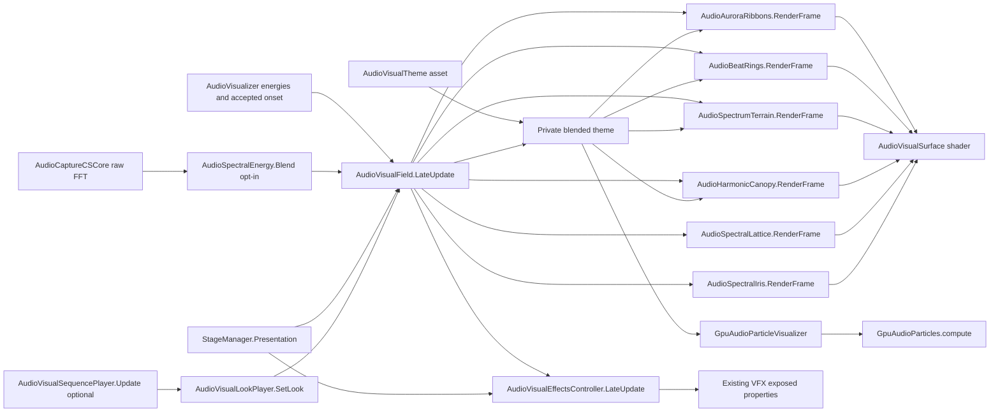

# 音乐空间视觉研究

本轮目标：在现有桌面、音频分析、舞台、星尘和流星之外，增加有统一配色、不同时间尺度和空间层次的可编辑图形内容。恢复点：`codex/visual-research-before-20261022`。保留起始 `.gitignore`、`ProjectSettings/ProjectSettings.asset` 和 `showcase/` 改动；只做本地提交。

## 资产规格

| 项目 | 本轮基线 |
| --- | --- |
| 引擎 | 当前工程 Unity 6000.3.11f1、URP 17.3；Windows PC XR，头显预算待实测 |
| 形状语言 | 极光光带、节拍光环、频谱历史地形；安静时留白，高潮时增层 |
| 颜色 | 青蓝、紫罗兰、琥珀、翡翠四种可编辑主题；一个主色、邻近色及少量高光 |
| 空间 | 米、Y-up；以 Screen 为局部坐标，主要位于两侧、下方和后方；中央阅读区屏蔽、近眼渐隐 |
| 几何 | 初始 6 条细分光带、最多 8 圈节拍环、48×48 频谱历史网格；不新增实时灯和碰撞 |
| 材质 | 原生 URP 非光照透明 Shader，程序化纹理，无外部位图；双眼实例化入口、深度测试及近眼渐隐 |
| 数据 | 复用 AudioVisualizer 的音频能量和真实瞬态；复用 StageManager 的只读输出；手动演示输入与真实音频明确区分 |
| 编辑 | ScriptableObject 主题、Prefab 参数、Editor 安装/修复、预览实验场和可重复渲染入口 |
| 源与许可 | 本项目 C# 网格生成器、Shader、参数资产即完整制作源；本轮原创，无外部下载素材 |
| 验收 | Unity 导入、Shader、资产重载、生命周期、瞬态去重、静音、几何边界、接管及后台真实帧；静态构建另记 |

## 工作单元

1. 原生可编辑光带、节拍环和频谱历史：独立实验场、主题资产、预览和主场景安装。
2. 现有 GPU 粒子的可选形态与过渡：保留原星尘默认，使用可调参数增加空间图案。
3. 视觉编排、主题切换与运行时控制：统一色彩、过渡与强度，避免效果同时抢占注意力。
4. 回归、真实音频回放、代表性画面和持续运行：只记录实际证据；头显缺失时明确留待设备验证。

每个单元完成后在下方记录入口、验证与本地提交。未通过导入、运行和效果检查的内容不作为完成交付。

## 2026-10-22 第一轮实现与实测

- 新增原生光带、瞬态环和频谱历史地形，四个主题、材质、Prefab、独立实验场均为真实 Unity 资产。光带包含细纤维、多尺度流动噪声、雾层和高光；环包含分段轨迹与扫描亮点；地形包含网格、等高线和节点。
- 原 GPU 星尘增加可选三臂星系、环面及连续过渡，默认仍为 Stardust；形态固定到场景锚点，保留相机移动补偿与近眼距离限制。空间主题可以同步粒子颜色。
- 主场景已接入现有 AudioVisualizer、StageManager 和 Screen；演示信号只在实验场启用。主题使用私有副本平滑过渡，不修改共享资产。
- 已执行 Unity C# 导入、Shader 检查、网格边界/复用、瞬态去重、重新启用、静音衰减、历史缓存和主题隔离验证；GPU 三种模式实际 dispatch/readback 的位置有限且位于配置范围内。
- 实验场桌面 Play Mode 运行约 142 秒，确认星系、环面及三层网格效果可见，运行后段无新增错误。修复 PreviewRenderUtility 中未启用对象不触发 OnDestroy 的资源泄漏；验证及主题预览前后网格数量为 80 → 80。
- `dotnet build Assembly-CSharp.csproj --no-restore --nologo` 基线因既有 PerformanceMonitorPanel 的 LibreHardwareMonitor/Computer 引用缺失失败：13 个 MSB3277 警告、2 个错误。不能将 Unity 导入成功等同于此命令通过。
- 无头显，XR 启动有 MetaXR ErrorFormFactorUnavailable。真实音乐听测、XR 双眼效果、设备性能、黑屏下后台帧推进尚未验证。NightDesk 当前处于用户接管状态，遵守接管，不自动恢复遮罩。

证据保存于项目 `Temp/AudioVisualResearch/`，不提交生成截图与机器日志。

## 使用与运行链路

入口为 `Tools/MR-VD/Spatial Audio`：生成缺少资产、安装/修复当前场景、升级实验场、生成主题联系图，以及执行网格与 GPU 验证。安装操作应在 Edit Mode 执行；现有主题和 GPU 默认模式会保留。实验场使用显式合成输入，不能用它证明真实音频分析准确。

源码入口：[AudioVisualField](../Assets/AudioVisuals/Runtime/AudioVisualField.cs)、[主题](../Assets/AudioVisuals/Runtime/AudioVisualTheme.cs)、[编辑器工具](../Assets/AudioVisuals/Editor/AudioVisualFieldTools.cs)、[验证](../Assets/AudioVisuals/Editor/AudioVisualValidation.cs)、[GPU](../Assets/AudioReactiveParticles/Runtime/GpuAudioParticleVisualizer.cs)。后续研究在此基础上逐个完整单元推进，不把视觉短语调制称为自动歌曲段落识别，也不把 synth 能量称为人声或语义检测。

## 第二轮：频谱形状与粒子微结构

入口：[AudioSpectralShape.Analyze](../Assets/AudioVisuals/Runtime/AudioSpectralShape.cs)。48 个对数频率区间先积分 FFT、压缩和平滑，再输出归一化的对数频率重心、分散度、平坦度和正向变化量。它们是外观描述器，重心不是以 Hz 表示的标准线性谱质心；正向变化使用平滑后的展示频谱，受更新率影响，不能用作精准起音估计。BPM、调性和已接受节拍事件保持原分析链。

重心影响光流，平坦度影响细丝扰动，正向变化影响微高光；主题 `spectralInfluence` 可独立调节。GPU `formationDetail` 增加稳定身份的五层细丝、稀疏外晕、编织环面、细尘与少量高亮节点，`spectralResponse` 调节描述器影响。默认星尘形态不使用这些形态细节。

验证：窄带低/高频、静态频谱、均匀频谱、静音/恢复和 NaN/Infinity 输入测试通过；三种 GPU 形态实际读回通过。桌面合成 Play 65 秒、3188 帧时粒子 ready，星系和环面截图已检查。启动仍有缺少头显的 MetaXR 错误；一次 CLI 序列化整个 Frame 时访问默认矩阵的 rotation 触发工具断言，后续只输出必要标量，不能将它算成视觉运行故障或忽略未验证项。本地提交第一轮为 `312d425`。

## 预研依据与下一阶段

2026-10-22 实际读取的公开资料：

- [librosa spectral.py](https://github.com/librosa/librosa/blob/main/librosa/feature/spectral.py)：以频谱分布统计描述声音形状。本轮采用更适合展示的对数区间变体；后续真实音频实验需独立量测其稳定性、频率分辨率与延迟。
- [Unity VFX Graph 17.3 Custom HLSL](https://docs.unity3d.com/Packages/com.unity.visualeffectgraph@17.3/manual/CustomHLSL-Common.html)：支持自定义 block/operator、纹理与缓冲输入，可将可复用场函数用于 GPU 粒子；文档明确梯度使用专门打包与采样函数，不能当成普通纹理契约猜测。

研究路线按证据推进：多速率特征（展示连续量与精确瞬态分开）、频段驱动的空间纤维、谐波/打击分解、确定性场与多尺度粒子、可编辑演出编排。神经音频嵌入和歌曲段落识别暂不引入运行依赖，先比较离线精度、许可证、推理延迟和 PC XR 预算；以上属于预研方向，未声称已实现。已有 VFX Graph 属性由 `AudioVisualEffectsController` 驱动，后续接入需先检查图的真实属性，避免虚设参数或重复写入。

## 第三轮：编织频谱穹顶与编辑工作台

[AudioHarmonicCanopy.RenderFrame](../Assets/AudioVisuals/Runtime/AudioHarmonicCanopy.cs) 复用 4830 顶点网格，15 条有独立相位与深度的频谱纤维围绕中央开口；各位置由展示频带驱动，细线中有移动亮点。名称仅描述几何形态，不声称检测出音乐谐波。线数、细分、半径、线宽、层距、编织圈数/幅度、频带位移、中心与种子均为 Inspector 参数，主题可调 canopy 权重。

`Tools/MR-VD/Spatial Audio/Open Visual Workshop` 打开[工作台](../Assets/AudioVisuals/Editor/AudioVisualWorkshop.cs)，可选主题、构图、强度、过渡、GPU 形态，查看描述器、生成合成预览、截图到项目 Temp，以及 Bake 当前网格为新 Prefab。Bake 保留网格、独立材质、冻结视觉时间和 SourceParameters.json，不覆盖源资产。静态快照没有活动 Screen 绑定，因此明确禁用其阅读屏幕遮罩；正式程序化效果继续保护阅读区。示例快照保存在 `Assets/AudioVisuals/Snapshots/`。

已用 Editor API 升级并重载原 Prefab、实验场和主场景，重复升级仍为一个 canopy。网格/Shader/资源清理测试通过，原有层数量保持完整；示例快照重载验证四层网格与 Style 0/1/2/3、冻结时间均持久化。桌面合成 Play 在 109.55 秒、5453 帧时穹顶正常显示；运行期间只有已知无头显 MetaXR 启动错误。工作台截图入口已实际写入 Temp 且查看画面，当前项目的 AndroidBluetooth 全局调试 IMGUI 也会出现在 backbuffer 截图中；纯相机主题预览不包含该界面。最终 15 条配置另经过几何边界与 Shader 检查。

## 第四轮：现有 VFX Graph 编排与隔离实验场

[AudioVisualEffectsController](../Assets/Scripts/AudioVisualEffectsController.cs) 在 StageManager 与 AudioVisualField 之后执行，读取频谱形状与私有混合主题。重心提高背景细尘发射，平坦度调制烟雾密度，正向变化与接受的瞬态短包络调制激光、地环。调制强度与调色混合可在 Inspector 独立调整。失去有效音频源、禁用效果或禁用控制器时将四图发射/强度归零；黑场同时归零。停止生成不保证立刻删除已有粒子。

实际图契约：BackgroundParticles 为 SpawnRate/ParticleColor，SmokeEffect 为 Density/SmokeColor/TransformPosition，LaserBeamEffect 为 BeamIntensity/BeamColor，GroundRingEffect 为 RingExpansion/RingColor。原主场景四图均不活动，保持该状态，只连接控制器数据源；不会把不可见图强行启用。通用参数仍采用 HasFloat/HasVector 检查。

`Tools/MR-VD/Spatial Audio/Build Missing VFX Graph Laboratory` 保存独立 `Assets/Scenes/AudioGraphLaboratory.unity`，使用原四图和显式合成输入；不会发射合成流星。`Validate Existing VFX Property Writes` 使用隔离组件验证四图属性存在、调制增量、主题一致与黑场归零。已通过 Unity 导入和该属性测试，实际 Play 观察到背景约 98 个、激光 12 个、地环 10 个活动粒子；烟雾计数 -1，不能据此确认其可见。实际停用控制器后四图强度读回为零。无头显启动错误仍存在。

视觉检查发现原激光/地环图呈现方形粒子，当前只验证编排通路，不能称其外观完成；下一单元针对 VFX 输出/材质和几何层次继续改进，并再次渲染。场景变更与原图源资产保持可分离。

## 第五轮：可复现 VFX 细节纹理与烟雾发射率

`Generate and Apply Detailed VFX Surfaces` 根据 `Textures/GraphTextureSettings.asset` 生成四张 256×256 RGBA 遮罩：带微光芒的柔星、四层扭曲噪声薄雾、脉冲细丝、分层轮廓轨迹。默认种子 8457；分辨率、晕光、雾尺度和纤维频率均可编辑。原始制作源为 [AudioGraphSurfaceTools](../Assets/AudioVisuals/Editor/AudioGraphSurfaceTools.cs) 和参数资产，未使用外部素材或引入第三方许可证；纹理为项目程序化原创资源。线性色彩、Clamp、Trilinear、mipmap、RGBA32，默认四张含 mip 的显存预算约 1.33 MiB，不含粒子和输出缓冲。

生成器通过 VFX Graph 17.3 自身的图模型和序列化 API 绑定输出 mainTexture：普通粒子用柔星/薄雾，Strip 用纤维/轮廓。包的图模型 API 为内部接口，因此反射仅限 Editor 工具，升级 VFX 包后必须重新验证；运行时不依赖该反射。保持现有节点、公开属性、GUID 与主场景激活状态。

检查真实图连接发现 SmokeEffect 的 `Density` 直接进入每秒发射数，而不是归一化密度。控制器新增 Inspector `smokeParticlesPerSecond`（默认 120），按归一化强度换算发射率；原 SmokeDensity 备用属性仍保持归一化契约。默认实验场运行 17.09 秒时烟雾实际存活 21 个、发射率约 3.246/秒，截图可见淡青色烟丝；不会将旧的 -1 计数记为成功。实际截图 `Temp/AudioVisualResearch/play-20261022-174835-446.png` 已查看，柔光点替代此前硬方块，整体层次仍需继续打磨。

重复生成与 Unity 导入通过，四图属性/频谱/调色/黑场验证通过，新增每秒发射率检查通过。重新读取四张 importer 确认线性、mip、Clamp/Trilinear 配置持久化。验证窗口控制台没有新增 error，Editor 无编译失败；不等同于设备、真实音频或 Player 性能验证。

## 第六轮：带传播时差的频谱星座

[AudioSpectralLattice.RenderFrame](../Assets/AudioVisuals/Runtime/AudioSpectralLattice.cs) 用三维三角截面细丝构成开口星座，默认 3 层、每层 20 节点、97 连接，每连接 8 段，共 2619 顶点。静态种子保持形态稳定，48 个展示频带改变节点局部径向位移；连接带有端点结、细节刻度与流动高光。最多保留 8 个接受的瞬态包络，沿开口弧形传播（默认 0.75 秒），不使用全屏同步闪烁，也不声称网络代表音乐相似性或检测到的和声。

Inspector 可调节点数、层数、连接细分、线半径、整体半径、高宽比、深度间距、频带位移、传播时长、中心和种子；主题 `lattice` 控制独立权重。组件使用既有近眼淡出和阅读遮罩；禁用清空传播记录，显式释放网格供编辑预览清理。工作台可升级缺少的 Prefab 组件，重复运行不增加重复层；Bake 的通用效果收集会保留该组件几何、Style 4 和源参数。已有四层快照保持原样。

实际验证：传播起点/远端时差、Clear 不重放、2619 顶点预算、有限边界和网格复用测试通过；全部既有网格/Shader/GPU 检查通过。四主题联系图已渲染查看。桌面合成 Play 49.28 秒、2441 帧，截图 `Temp/AudioVisualResearch/play-20261022-180331-375.png` 已查看；主场景重载检查 demo=false、星座数量为 1、绑定有效，AudioVisualizer/VirtualStage 引用保留。`dotnet build` 仍为基线 LibreHardwareMonitor/Computer 缺失的 2 错误、13 个 MSB3277 警告，不能记录为构建通过；Unity 编译与视觉运行验证独立成立。真实音频听感、头显和 Player 性能仍待验证。
## 第七轮：阅读空间的实际 GPU 像素检查

[AudioVisualPixelValidation](../Assets/AudioVisuals/Editor/AudioVisualPixelValidation.cs) 通过隔离预览相机真实渲染并读取像素。菜单 `Validate Reading Clearance Pixels` 覆盖全部 5 种生产表面样式、前后景、25 度旋转阅读平面、屏幕位于相机后方、0.5 米近眼淡出及 ±0.032 米独立单目视点。中央必须透明，外侧保留亮度；测试不修改用户场景，显式释放网格、材质、纹理和 RenderTexture。

`Validate GPU Particle Reading Pixels` 使用生产粒子 Shader 和单粒子 ComputeBuffer，通过实际 RenderPrimitives 提交与像素读回复现旧问题：屏幕前方的粒子仍出现在中央阅读射线上。修复取消交点必须落在视点与粒子之间的限制，使 GPU 与空间网格一样清除完整阅读射线；Shader 改用当前相机/眼睛位置，完整 Rect 边界替代居中 HalfSize 假设，保留非居中 Pivot。旧的独立相机中心 uniform 已删除，运行时仅更新新的内部 Shader 契约，不改场景序列化字段。

修复后 GPU 前后景、非居中矩形、旋转平面、左右独立视点像素检查通过；五种网格表面像素检查通过。报告写入 `Temp/AudioVisualResearch/reading-pixels.txt` 与 `gpu-reading-pixels.txt`。这包含真实 GPU 渲染证据，仍不是单通道立体头显、设备体验或 Player 性能认证；粒子按中心裁剪，跨越遮罩边缘的大粒子可能发生整体显隐，当前小粒子方案保持原行为。
## 第八轮：因果频谱层次预研

实际阅读 [librosa.decompose.hpss 源码](https://github.com/librosa/librosa/blob/main/librosa/decompose.py)（2026-10-22）：时间/频率中值和幂次软遮罩思想来源于其说明的 Fitzgerald 2010 方法。本项目独立实现 [AudioSpectralLayers.Analyze](../Assets/AudioVisuals/Runtime/AudioSpectralLayers.cs)，没有复制代码或引入 librosa 依赖；只处理 48 个已压缩、平滑的对数展示频带，不重建音频、不等同完整 HPSS、更不识别人声/乐器。因果 9 帧时间中值、7 频带局部中值、20 Hz 更新，不使用前视；启动覆盖约 0.45 秒，中值对变化存在历史滞后。帧卡顿不复制同一快照填满历史。

Frame 的 spectralLayers 为持续比例、宽带比例、对比分离权重、预热覆盖。两比例互补；持续宽带噪声保持 0.5/0.5 且对比为 0，避免强行分类。分离权重乘预热覆盖与主题 `layerResponse`，仅轻量调制极光表面高光/细流和穹顶载波速度，不改变原 BPM、调性、节拍接受链或整体亮度。工作台显示原始描述符，Bake 保存新 Shader 向量；设 layerResponse=0 可关闭调制。

最新程序集已确认包含新增方法与 Frame 字段后，稳定窄带、首次宽带、持续宽带模糊、静音复位、NaN/Infinity 清理、30/60/120 FPS 采样覆盖与 200 次稳定路径零托管分配测试通过。既有网格/GPU 与五样式阅读像素检查通过。算法初版 2000 次窄带更新微基准约 12.8 微秒/次（Editor 单次测量，不是 Player 保证）。真实音频分层可靠性尚未验证，不称为音频分析质量提升。

本轮出现 Bee 构建后端访问冲突及进程创建失败（系统提交余量约 0.3 GB，物理空闲约 6 GB）。保存 DAG 哈希/副本至 Temp 后请求 CleanBuildCache，清理重建仍受资源限制；最终通过官方 AssetDatabase API 将本项目 DesiredWorkerCount 从 3 临时收缩为 1，提交余量恢复约 3 GB，正常编译成功。未结束用户其他程序，未更改分页或全局系统设置。早期旧程序集测试不作为新增回归证据，恢复后已明确验证方法存在并重新运行。
恢复后实际合成 Play 至少 47.55 秒、2348 帧，分层向量持续更新，截图 Temp/AudioVisualResearch/play-20261022-182252-742.png 已检查。五层 Bake 重载验证 Style 4 与全部材质的 _SpectralLayers 覆盖值持久化通过；临时验证快照已由 AssetDatabase 删除，原示例快照保留。运行窗口仅记录已知无头显 MetaXR 启动错误。

## 第九轮：独立 HDR 展示场与可编辑 Look

`Build Missing Cinematic Showcase` 保存 `Assets/Scenes/AudioVisualShowcase.unity`、三个 Look/独立主题与原生 VolumeProfile。Aurora Cathedral 强调持续光流与穹顶，Solar Percussion 降低上层持续亮度、强调地环，Jade Orbit 强调环面与星座。Look 仅组合主题、强度、构图和 GPU 形态；在工作台选择并 Apply，或修改场景 `AudioVisualLookPlayer` 的显式引用，通过 Inspector 菜单应用。生成工具只补缺失资产，保留手工编辑。

检查发现正式 URP 管线 supportsHDR=false，相机 allowHDR 本身不足以启用 HDR。展示专用管线复制原 URP 资源并启用 HDR，不改原资源；场景 `AudioShowcasePipelineScope.OnEnable` 临时切换质量管线，OnDisable 在仍为自己所设管线时恢复之前值。实测 Play 中 HDR=true、退出后 HDR=false 且原 Quality override 为空。VolumeProfile 使用 Bloom（阈值 .25、强度 .65、散射 .6）、ACES 和曝光 +1.1；后期与原渲染器共享资源的设备性能尚未验证，不自动迁入正式场景。

`Capture Desktop Camera without Debug Overlay` 用 URP SingleCameraRequest 导出 1600×1000 PNG 到 Temp，包含相机后期与当前 GPU 粒子提交，不包含既有 AndroidBluetooth OnGUI。仅支持正在运行的单目桌面主相机；头显捕获独立。已实际查看 `camera-20261022-183228-651.png`、`camera-20261022-183305-002.png`、`camera-20261022-183350-895.png`。第一次启动即时请求有一次 CLI 5 秒超时，稍后正常完成，不能当成首个请求已生成图片。

实际合成 Play 至少 78.4 秒、3890 帧，三配置运行切换与明暗细节已查看。`Validate Authored Showcase Looks` 确认三独立主题/形态、渲染不改变主题 JSON、HDR/后期资产完整。编辑器编译通过。展示场为显式合成输入，画面不是实际歌曲或头显设备效果证明。
## 第十轮：GPU 可见度与舞台生命周期

AudioVisualField.Frame 增加显式 visibility，真实输入跟随 StageManager 的黑场值，合成实验场为 1。GPU 在执行顺序 130（空间场 120 之后）更新提交，绑定场的 opacity 乘可见度；绑定场禁用或缺少主题时为 0，未绑定场保持独立使用。黑场继续模拟，不销毁/重建缓冲，使恢复显现延续运动；不修改用户既有 opacity/渐变。

`Validate Running GPU Visibility` 在显式合成 Play 中检查真实运行组件的渲染提交 PropertyBlock：全黑、0.5 渐隐、恢复、场禁用/重启与无绑定状态，结束恢复引用与帧。检查通过。禁用后实际纯相机图 `camera-20261022-184030-295.png` 只剩背景，恢复后 `camera-20261022-184051-467.png` 重新显现，均已查看。启动即时 CLI 检查有一次 5 秒超时，之后正常执行；不把超时计为通过。Unity 编译与 diff 检查通过；没有真实 Stage/头显设备黑场体验认证。
## 第十一轮：GPU 编织流结

ParticleFormation 在旧值后追加 FlowKnot=3，保持 Stardust=0/SpiralGalaxy=1/Torus=2 的序列化兼容。闭合两圈轨迹与奇数瓣数形成空间流结，五条稳定细粒子泳道穿插，纵向高光包络沿粒子身份移动。Inspector knotLobes（有效奇数 3/5/7）、knotDepth、既有细节/厚度/半径/旋转/过渡参数均可编辑；轨迹为解析视觉造型，不是混沌吸引子、流体仿真或音乐拓扑分析。单独 knotBlend 平滑进入/离开，沿用受限吸引速度与近眼/体积约束。

新增独立 Violet Knot Look/主题资产；原三个配置保持。四形态实际 Compute dispatch/readback、有限位置/速度及近眼/体积边界通过，Look 验证升级为四配置并通过。展示场实际 FlowKnot Play，纯相机截图 `camera-20261022-184525-441.png` 已查看，闭合粒子泳道在穹顶内部交错；这仍是合成视觉输入。Unity 编译与 diff 检查通过。GPU Player 性能、设备立体深度与真实音频表现未验证。
## 第十二轮：轮换稳定性与方向性光痕

`AudioVisualSoak` 是显式菜单启动的 8 分钟合成轮换采样器，按分钟切换四个 Look，每秒写 CSV，记录帧间隔、托管内存、Unity 已分配/保留内存和生成网格数；停止或脚本重载会恢复起始 Look/形态。它不会自动启动、写场景或声称 Player/GPU 计时。当前轮换已超过 229 秒，CSV 记录生成网格稳定为 13 个；托管内存随回收波动，未见由网格重复生成造成的单向增长，最终结果待采样完成或主动停止。

GPU 粒子新增可编辑 `motionStretch`，按视点投影速度拉伸粒子四边形，默认 0，启用时上限为基础半径三倍，适合 FlowKnot 短光痕；不改变 Compute 粒子位置和缓冲契约。实际生产 Shader 像素测试验证速度向右时亮部只向右扩展，置零恢复圆形尘点；展示场使用 1.2。包围盒略按拉伸余量扩大，避免高速光痕被 RenderParams 过早裁掉。

预研增加 `Tools/AudioVisualResearch/Generate-ReferenceAudio.ps1` 和 C# 源：生成 48kHz 单声道 16-bit、6 秒、seed 8457 的低音 110Hz、高音 3520Hz、110/220/440Hz 床、宽带脉冲、混合与静音 WAV；`sources.txt` 记录来源与限制。它们是可复现的受控 PCM 夹具，不自动播放或注入 Windows 捕获，也不代表真实歌曲听感；下一步可在 Unity/CSCore 设备链中手工选择文件或外部回放进行端到端验证。
采样最终于 2026-10-22 18:59:21 完成 480.02 秒，预热后观测 22961 帧，Editor frame interval p95=20.939ms，生成网格 13→13。475 行一秒采样中 Unity allocated 为约 1307.17～1377.84MiB，结束 1308.60MiB；托管内存约 1259.73～1434.03MiB，呈回收波动。日志 `soak-20261022-185121.csv/.txt` 保存于 Temp；这是含原全局组件、Editor 与采样器开销的观察值，不是单个视觉系统净内存或无泄漏证明。观察完成后 IsRunning=false，原 Look 已恢复，Play 正常退出。PCM 夹具重复生成 SHA-256 一致。

现代模型研究与许可证/时延边界另见 [audio-visual-frontier.md](audio-visual-frontier.md)。当前没有引入神经运行依赖。
## 第十三轮：受控 PCM 经过同款 CSCore FFT

[AudioLogSpectrum.SampleBand](../Assets/AudioVisuals/Runtime/AudioLogSpectrum.cs) 抽出原有频带积分与压缩计算，AudioVisualField 与受控测试共享正式实现，不改变 40Hz～8kHz/48 对数频带的既有映射。额外防护无效采样率/数组及非有限 FFT 值，不依赖捕获单例。

`Validate Authored PCM Features` 读取自制 48kHz mono PCM、调用生产同款 CSCore Fft4096，使用 .5 FFT 平滑及相同展示 attack/release，然后计算形状与因果层次。低音 110Hz 的峰值频带 9、高音 3520Hz 为 40；平均展示重心约 .1864/.6660，排序通过；静音所有能量为 0。持续谐波床 persistent≈.6581，独立宽带脉冲 broadbandPeak=1.0，有限输出与基础对比通过。报告 `Temp/AudioVisualResearch/pcm-features.txt`。

**限制实测**：混合床/脉冲的 broadbandPeak≈.3708，相比纯音床 .3430 仅小幅变化，不能称其已可靠分离打击与持续声。独立脉冲的展示最大能量仅约 .0207，而窄带音较高，反映当前平均频带积分与压缩的显示尺度，不是感知响度。中值层次继续只负责轻量表面调制，精确瞬态继续来自原 AudioVisualizer。不要用对照夹具的通过结论替代混合音乐泛化或算法质量提升。测试不播放、不启动 WASAPI、不修改设备/PlayerPrefs，不认证 BPM/调性/真实音乐准确率。

Unity 编译、受控 PCM 测试及原网格/GPU/频谱回归通过；diff 检查通过。
## 第十四轮：连续频谱地形与像素宽度等高线

频谱历史在 20Hz 采样点之间连续插值推进，保留有限环形缓存；不通过复制同一 FFT 补齐卡顿帧。新增跨采样边界的顶点/透明度连续性检查，受控 .2→.8 频带测试在边界前后 .0002 秒内最大变化低于 .003，通过。侧向峰脊向 accent 轻量偏色，原始透明度保留。

主题 Terrain Relief 暴露 contourDensity/contourStrength/ridgeGlow/gridStrength，私有主题平滑、MPB 和 Bake 材质同步传递。实际隔离渲染发现固定相位线宽在浅坡上形成大片三角形亮斑；改为按 fwidth 换算像素距离，并淡出平坦/未解析轮廓后，四主题联系图的亮斑消失。峰脊掠射光仅沿网格线，避免把线框地形变成整片发光面。

Unity 网格/地形连续性/频谱/GPU 回归与五样式阅读遮罩像素检查通过；Shader 无编译错误。展示场合成 Play 42.53 秒、2104 帧，纯相机图 camera-20261022-191648-807.png 已查看；细节在 HDR 展示中保持可辨，尚未验证头显浅坡闪烁或真实音乐效果。原 dotnet 缺失依赖基线不因本轮视觉检查而视为通过。

## 第十五轮：光谱虹膜与雕塑编排

[AudioSpectralIris.RenderFrame](../Assets/AudioVisuals/Runtime/AudioSpectralIris.cs) 新增 32 片、72 段的螺旋折面花瓣，共 4672 顶点。稳定频带身份改变伸展，接受瞬态触发短时扩张和折面加深；旋转/折深/花瓣宽度/孔径/频谱位移/瞬态衰减/种子均由 Inspector 编辑。程序表面包含细肋、侧缘、弯曲叶脉和移动光包。它是解析视觉雕塑，不声称虹膜或花瓣代表实际音源结构。

主题 iris 默认为 0，已有配置不增加该层网格生成成本；Sculpture 枚举追加到末尾，保留旧序列化值。第五套 Opal Iris Look 使用青紫色、较低发光和以雕塑为主的编排，旧四 Look 保留。菜单及工作台提供 Upgrade Spectral Iris in Prefab，重复调用不增加节点；原生 Prefab 与新增 Look/主题都已保存。中央空间继续使用实时阅读射线遮罩及近眼淡出，雕塑强度随全局 intensity 和舞台 visibility 平滑，禁用清空瞬态。

实测修复 sin(pi) 端点微小负值进入分数幂造成的 NaN；网格有限值/复用、瞬态形变、零强度后透明度归零回归通过。六种生产表面阅读像素检查与五套 Look 绑定/主题隔离检查通过；六层 Bake 重载并确认虹膜 Style 5 通过，临时验证资产随后由 AssetDatabase 删除。最新完整检查 CLI 曾 5 秒超时，但 validation.txt 于 19:49:43 写入 PASS，未将超时当作测试通过证据。

首版合成 Play 610.63 秒/30461 帧；细化版 318.21 秒/15852 帧；最终强度契约版 97.94 秒/4866 帧。最终图 camera-20261022-195111-229.png 已查看；运行中 intensity=0 后 sculptureWeight≈1.46e-13、虹膜最大 alpha≈1.07e-13。以上为桌面 Editor 合成输入，尚无头显/真实音乐/Player GPU 性能认证。所有旧用户未提交内容保留，只本地提交。
## 第十六轮：低预算侧向薄雾细节

`Add Missing Showcase Side Mist` 通过 AssetDatabase 复制原 SmokeEffect 为独立 `Graphs/ShowcaseMist.vfx`，使用 VFX 17.3 原生模型 API 将输出尺寸设为 .65；保留原图容量 256、5–8 秒寿命、程序雾纹理和既有属性契约。源 `AudioShowcaseAtmosphereTools` 可复现初始化；创建只补缺失资产和节点，已有原生 Graph/位置/Controller 设置由用户继续编辑。未修改原 SmokeEffect 或启用正式场景的图。

展示场左右各一个低速发射器（默认 smokeDensity .14、每秒基数 80、master .5），跟随空间场调色/频谱。它们是透明薄雾精灵，不是体积光、真实散射或流体模拟；当前没有阅读射线裁剪，因此只加入独立桌面展示场，不直接用于正式 XR 阅读空间。

桌面合成 Play 113.85 秒/5652 帧；17.33 秒时左右存活 25/23、发射率约 3.65/秒，86.11 秒时存活 24/22。禁用 Controller 后 Density 立即为 0，113.85 秒时两侧均清空。纯相机图 camera-20261022-200206-832.png 已查看，侧下方只有轻微细节；这不是测量过的 GPU 性能预算。重复生成前后场景 SHA-256 一致，四原图暴露属性/频谱/调色/黑场回归通过。顺带修正验证报告的表面样式计数为六种及虹膜覆盖文字；不扩大已有测试结论。

工程 Assets 未发现 WAV/MP3/OGG/FLAC/AIFF 样本；目前不能声称已验证真实音乐听感，也不下载未知版权歌曲或自动扬声器播放。

## 第十七轮：可编辑视觉序列

`AudioVisualSequence` 原生资产保存 Look/时长序列，可按秒或显示 BPM 拍数计时，最多 128 段。`AudioVisualSequencePlayer.Update` 显式启动后推进，默认为不自动播放；支持暂停/恢复/下一段/停止，安静或源禁用时暂停时钟。单帧补偿限制 1 秒，避免卡顿后补播多个长段；拍数时钟积分 BPM，不使用慢语义结果伪造节拍。非循环结束保留最后 Look，再次 Play 重新开始；Stop/disable 恢复启动时 Look（会重新应用其参数，不保存每个临时手动参数快照）。

示例 `Five Look Journey.asset` 顺序 Aurora/Jade/Opal/Violet/Solar，虹膜 64 显示拍，其余 32。生成工具只补缺失原生资产与展示场组件；Inspector 可改顺序/时长/循环，工作台 Find 后可直接控制。手动 Apply Look 会暂停正在运行的序列。运行中删短数组会回到有效首段，无效资产停止并恢复；播放器不改写共享序列资产。

真实 Play 中隔离控制测试通过：非法 delta/BPM、拍数边界、秒计时、暂停/恢复、手动 next、Stop/disable 恢复、非循环完成/重启、循环回绕、运行中缩短和资产 JSON 不变。展示场实际运行 146.20 秒/7284 帧，帧时钟到 cue1 后自然切到 cue2；纯相机图 camera-20261022-201422-913.png 与 camera-20261022-201441-824.png 已查看，停止恢复 Aurora Cathedral。此为预先编排演示，不是自动识别歌曲结构或跨歌曲泛化证明。
## 第十八轮：受限三维解析卷流

GPU 形态追加 CurlNebula=4，旧 Stardust/Galaxy/Torus/Knot 数值不变。`NebulaVelocity` 使用 ABC 解析向量场：基础每个分量均与自身坐标无关，因此解析散度为零；音频连续能量/形状仅慢调系数。独立径向约束将粒子留在种子对应的壳层，七组稳定相位防止全部人口收缩到一束。径向约束与速度平滑改变原场性质，不能把最终视觉称为不可压流体仿真。

Inspector 暴露 curlScale/curlSpeed/curlConfinement；速度上限 2m/s，沿用体积/近眼保护、世界锚点、阅读遮罩与渐变。根据相机中心与锚点距离限制云团半径，减少远锚点反复触及全局 wrap 的长条伪影。第六套 Amber Flow Look 单独保存暖色/冷色交错与轻量背景，旧 Look 和现有 Five Look Journey 不被改写。

首次短 GPU 检查通过；进一步长期检查使用最新 Compute 实例，128 粒子、30Hz×3600 步（120 模拟秒），均有限、速度≤2.01、体积/近眼边界有效，平均到测试锚点距离约 2.590m、平均速度约 .098m/s，空间方差通过，未停到单点。完整报告于 21:13:32 写入 validation.txt 并直接返回 PASS；六 Look 绑定与主题隔离验证通过。

运行中曾失去 Editor 主进程，未获取确定退出原因；旧日志已备份到 Temp，未擅自归因为流场。使用匹配 6000.3.11f1 恢复后重新进入 Play，使运行时 Compute 克隆采用最新代码。最终 Play 168.67 秒/8393 帧，camera-20261022-205637-253.png 已查看，表现为多束交织卷流；此前热改源文件后的截图不作为新克隆验证。CLI 的延迟回调方案没有生成报告，已移除不可靠入口。真实音乐、头显与 Player GPU 性能仍未验证。
## 第十九轮：可编辑复杂度预算与隔离预览

AudioVisualComplexity 保存光带、环、历史地形、编织、晶格、虹膜及 GPU 粒子数量。Desktop Detail 上限 16753 网格顶点、4096 粒子（状态缓冲 192KiB）；Reduced Geometry 为 6990 顶点、2048 粒子（96KiB）。这是数量预算，不代表已测 XR 帧率，也未包含材质过绘制、VFX 或 Editor 开销。配置只在 Edit Mode 经工作台显式应用，支持 Undo，保留主题、变换和音频参数的独立编辑。

隔离实例逐档生成六类网格，实际顶点数匹配估计，所有顶点有限且根变换保留；释放预览前后网格数 35→35。Reduced Geometry 四主题联系图 theme-complexity-contact-sheet.png 已查看，保留主要轮廓和细线层次。预览只含网格，不包含 GPU 粒子与后处理。两档原生 ScriptableObject 已保存，默认场景密度不自动改变。

21:17 再次执行 dotnet build，仍为 LibreHardwareMonitor 缺失导致的 2 个既有错误和 13 个 MSB3277 警告；不能写成静态构建通过。Unity 实际复杂度验证通过；头显、Player GPU 计时和真实歌曲仍待验证。
## 第二十轮：虹膜视角光学风格

主题新增 irisIridescence/irisFilmCycles/irisEdgeLight，默认变色和边缘光为 0。虹膜 Style 5 使用实际表面的屏幕导数法线、双面绝对入射角与受限周期色彩，保持原色亮度上限并增加轻微掠射边光；它是艺术风格，不是物理薄膜/光谱渲染。参数随私有主题平滑，通过 MPB 提交，Bake 同步保存。Opal Iris 原生主题启用 .65 变色、2.4 周期、.3 边缘光，其余主题不自动增加效果。

真实 GPU 像素检查证明关闭效果时正面/65 度表面的调色一致，启用后颜色有显著差异；开启光学参数的六类表面阅读遮罩、前后几何与近眼淡出全部通过。合成展示 Play 57.53 秒/2867 帧时，Bake 重载的 _IrisOptics=(.65,2.4,.3,0)，临时快照随后通过 AssetDatabase 删除。camera-20261022-213441-244.png 已查看，虹膜表面肋纹、侧缘和青紫变化可辨；桌面相机证据不等同 XR 视觉舒适度、物理真实性或真实音乐泛化。
## 第二十一轮：瞬态频谱快照波前

AudioBeatRings 在接受瞬态时将 48 个展示频带保存到固定池槽位。环周用周期余弦映射插值这份快照，产生轻量径向/垂向起伏和局部 accent；后续输入不重写旧环形状。主题 ringSpectralRelief 默认为 0（保持圆环），Solar Percussion 设为 .35m，跟随私有主题平滑。缓存仅在容量/拓扑变化时分配，无新对象池或 GameObject；仍只有原接受瞬态能触发。

隔离检查通过：旧环不跟随后续频谱改变、两侧接缝闭合、关闭 relief 恢复圆环、Clear 后零谱不残留旧起伏、一个瞬态只发一个环且复用同一网格。完整网格/频谱/五 GPU 模式回归报告于 21:41:26 写入 PASS（调用 CLI 曾超时，报告与后续参数查询确认执行完成）。展示场合成 Play 58.58 秒/2892 帧、存活环 4，camera-20261022-214342-151.png 已查看。当前变化是艺术化谱形映射，不代表声波物理重建；真实音乐与头显视觉仍未验证。

## 第二十二轮：原始 FFT 聚合能量实验

受控等振幅 110Hz/3520Hz 夹具的 PCM 50ms hop RMS 峰值都为 .24748，40Hz–8kHz 原始 FFT L2 范数峰值约 .17452/.17502；而原对数展示频带峰值为 .79707/.21814。展示频带会按不同频宽平均，不能把该峰值直接当作整体响度。宽带脉冲原 PCM RMS 峰值 .11882，也确实弱于音调；不能把所有视觉弱响应归咎于算法。

新增可关闭 AudioSpectralEnergy.Blend：对完整原始 FFT 正频率 40Hz–8kHz 平方和开方、指数压缩，再按主题 aggregateEnergyWeight 混合整体视觉 energy。gain 默认 6，weight 默认 0，所有现有预设保持关闭。只在真实输入、未静音且捕获组件有效时启用；原 bass/detail、频带、瞬态、BPM/调性与合成演示路径保持独立，缺失输入回落旧能量。它不是 LUFS、感知响度或自动音量归一化。

生产纯函数的等功率分布一致性、零权重/缺失/无效采样率回落、NaN/Infinity/负值过滤、大值有限上限和稳态零分配检查通过；完整 Unity 回归于 21:52:50 写入 PASS，CLI 曾 5 秒超时但报告后续确认。21:53:11 受控 PCM 重跑，gain6 的低/高峰值 .64905/.65011、宽带 .20661、静音 0，既有投影/层次回归通过。仅证明受控数学行为；未以此宣称算法质量、真实音乐偏好或 WASAPI 端到端运行验证，因此预设不自动开启。
## 第二十三轮：GPU 粒子稳定频带身份

GPU 复用空间场既有 48 频带，通过 12 个 Vector4 常量传输（192 字节），不增加每粒子状态或持久 GraphicsBuffer。粒子用稳定互质步长映射覆盖频带，局部强度/尺寸随对应频带变化；运动、体积/近眼约束、形态和已接受瞬态不改。spectralBandResponse 默认 0，独立展示场启用 .6，可在 Inspector/工作台调整；无绑定、主题缺失或场禁用时关闭并清零常量。

实际 Compute 回读：128 粒子中提高单频带 3，仅其对应的 3 个粒子改变光强/尺寸，其余不变；响应为 0 时无论频带内容如何均恢复原值。五形态有限值/速度/空间边界回归报告于 21:59:18 写入 PASS，CLI 超时日志单独保留。新参数保存后重新进入 Play 使用最新 Compute 克隆；150.28 秒/7209 帧，camera-20261022-220225-300.png 已查看。运行时禁用绑定场检查 12 常量均为 0 且提交 opacity=0，重新启用后频带恢复。桌面合成验证，不代表真实歌曲分离、乐器身份或 XR 性能。